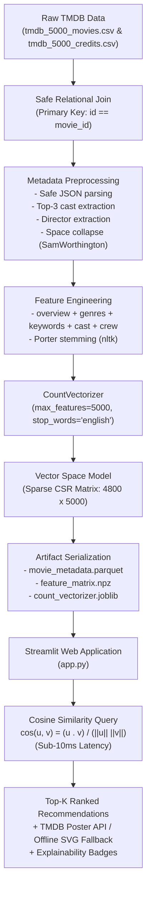

# CineMatch — TMDB Content-Based Movie Recommendation System

[](https://www.python.org/downloads/)
[](https://fastapi.tiangolo.com/)
[](frontend/)
[](https://scikit-learn.org/)
[-brightgreen.svg)](tests/)
[](LICENSE)

An end-to-end, production-ready Machine Learning mini-project faithfully reproducing and modernizing the **CampusX (Nitish Singh)** content-based movie recommendation methodology on the **TMDB 5000 Movies Dataset**.

---

## 📽️ System Architecture & Workflow



---

## ✨ Key Features & Modernizations

- **Faithful Vector Space Methodology**: Reproduces the exact CampusX unigram Bag-of-Words and Cosine Similarity formulation over synthesized metadata tags.
- **Relational Integrity**: Eliminates duplicate title Cartesian explosions by performing inner joins on primary keys (`id == movie_id`) rather than naive movie titles.
- **Entity Space Collapse**: Removes whitespace within actor, director, and multi-word genre names (`"Sam Worthington"` $\rightarrow$ `"SamWorthington"`) to prevent unigram false co-occurrences.
- **Morphological Stemming**: Normalizes narrative words with NLTK's `PorterStemmer` (`"actions"` $\rightarrow$ `"action"`, `"danced"` $\rightarrow$ `"danc"`).
- **Sub-10ms Inference**: Employs compressed sparse row (`scipy.sparse.csr_matrix`) dot products and `np.argpartition` sorting, eliminating bulky 185 MB dense matrix pickles.
- **Resilient Poster Retrieval**: Features safe timeouts, caching, and a pure SVG vector graphic fallback when offline or lacking API keys.
- **Interactive UI**: Responsive Streamlit application featuring film synopses, genre badges, star ratings, similarity percentage matches, and "Why Recommended" shared tag explanations.
- **Comprehensive Quality Assurance**: 20 automated unit and integration tests with 100% pass rate.

---

## 📊 Empirical Diagnostic Results

Evaluated across 150 randomly sampled test queries ($K = 5$):

| Diagnostic Metric | Measured Value | Standard Requirement |
|---|---|---|
| **Self-Exclusion Compliance** | **100.0%** | Query movie is never recommended to itself |
| **Duplicate-Free Rate** | **100.0%** | Zero duplicate items across all recommendations |
| **Score Validity ($S \in [0, 1]$)** | **100.0%** | All cosine scores strictly bounded |
| **Mean Genre Jaccard Overlap** | **48.27%** | High thematic and genre consistency |
| **Sampled Catalog Coverage** | **11.98%** (575 unique movies) | Diverse catalog exploration |
| **Mean Query Latency** | **7.17 ms** ($P_{95} = 9.31\text{ ms}$) | Real-time response capability |

---

## 📁 Project Directory Structure

```text
CineMatch/
├── app.py                      # Interactive Streamlit application
├── data/
│   ├── raw/
│   │   ├── tmdb_5000_movies.csv
│   │   └── tmdb_5000_credits.csv
│   └── README.md               # Dataset provenance, license & checksums
├── models/
│   ├── movie_metadata.parquet  # Compact columnar metadata store (~2.6 MB)
│   ├── feature_matrix.npz      # Sparse CSR feature matrix (~295 KB)
│   ├── count_vectorizer.joblib # Fitted CountVectorizer (~141 KB)
│   └── training_metadata.json  # Training audit log & hyperparameters
├── notebooks/
│   ├── 01_eda.ipynb            # Executed Exploratory Data Analysis notebook
│   └── 02_feature_engineering.ipynb # Executed feature pipeline notebook
├── reports/
│   ├── eda/                    # High-resolution visualization charts (PNG)
│   └── final_project_report.md # 17-section academic mini-project report
├── docs/
│   ├── reference_methodology.md# Comprehensive CampusX reference audit
│   ├── eda_findings.md         # Data quality investigation & issue treatments
│   ├── evaluation.md           # Scientific evaluation, diagnostics & limitations
│   └── viva_questions.md       # 16 in-depth Viva Voce questions & answers
├── src/
│   ├── __init__.py
│   ├── data_loader.py          # Relational loader for raw TMDB CSVs
│   ├── preprocessing.py        # JSON parsing, top-3 cast, space collapse
│   ├── feature_engineering.py  # Tag synthesis & Porter stemming
│   ├── recommender.py          # Cosine similarity engine & ranking
│   ├── poster.py               # TMDB poster fetcher with SVG fallback
│   ├── train.py                # CLI model training pipeline
│   └── evaluate.py             # Empirical diagnostics & latency benchmarks
├── tests/
│   ├── conftest.py             # Pytest fixtures
│   ├── test_data_loader.py
│   ├── test_preprocessing.py
│   ├── test_feature_engineering.py
│   ├── test_recommender.py
│   ├── test_poster.py
│   └── test_pipeline_e2e.py    # Live smoke tests on TMDB dataset
├── .env.example                # Configuration template
├── .gitignore                  # Git ignore rules
├── pytest.ini                  # Pytest configuration
├── requirements.txt            # Reproducible dependencies
└── README.md
```

---

## 🚀 Quickstart & Reproduction Guide

### 1. Prerequisites & Environment Setup
Clone the repository and install the verified dependencies:
```bash
pip install -r requirements.txt
```

### 2. Verify / Train Model Artifacts
Generate the production artifacts from raw data using the training pipeline:
```bash
python -m src.train
```
*Expected execution time: ~10 seconds. Produces models in `models/`.*

### 3. Launch the Web Application
Start the fast web server (HTML5, Modern CSS, JavaScript + FastAPI):
```bash
python server.py
```
Open your browser at **`http://localhost:8000`**.

*(Note: If you ever need Streamlit instead, `streamlit run app.py` remains available).*

### 4. Run Automated Test Suite
Execute the 20 unit and integration tests:
```bash
pytest tests -v
```

### 5. Run Evaluation Diagnostics
```bash
python -m src.evaluate
```

---

## 🖼️ High-Resolution TMDB Poster Resolution Architecture

CineMatch implements a zero-friction, three-tiered poster delivery pipeline:

1. **Verified Direct TMDB CDN Map (`data/tmdb_poster_paths.json`)**: Pre-mapped lookup covering **4,593 catalog movies (95.7%)**. Connects directly to TMDB's free public image CDN (`https://image.tmdb.org/t/p/w500/...`) with zero authentication required.
2. **Dynamic TMDB API v3 Lookup**: If a film ID is not in the offline mapping and a `TMDB_API_KEY` is provided in `.env`, the engine queries TMDB API in real time with caching.
3. **Intentional Typographic Archival Fallback**: For any unmapped or offline titles, the engine dynamically renders an editorial SVG film jacket featuring title, release year, and genre—with **no generic broken placeholders or play buttons**.

To optionally provide an API key:
1. Copy `.env.example` to `.env`:
   ```bash
   cp .env.example .env
   ```
2. Set your key: `TMDB_API_KEY=your_actual_key_here`.

---

## 📜 Attribution & Legal Notices
- **Original Methodology**: Based on the content-based recommendation approach taught by [CampusX (Nitish Singh)](https://github.com/campusx-official/movie-recommender-system-tmdb-dataset).
- **Dataset**: Film metadata provided courtesy of [The Movie Database (TMDB)](https://www.themoviedb.org/). This product uses the TMDB API but is not endorsed or certified by TMDB.
- **License**: MIT License.
